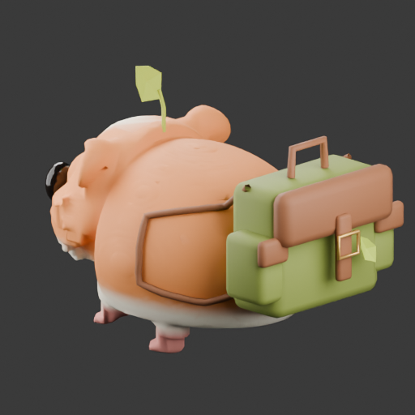

# Evidencia del ejemplo modular estático

El RAW nuevo y el ensamblaje se inspeccionaron con `scripts/glb_report.py`. Se ejecutó `scripts/modular_report.py` sobre el Blend y el GLB reimportado. Son inventarios, no certificaciones de diseño o FPS.

El [resumen de QA](resumen-qa.json) distingue base IA, accesorios/color manuales y pendientes. La [partición de módulos](particion-modulos.json) verifica cuatro nodos de cuerpo, doce de mochila y dos de brote, sin solapamientos y con unión exacta al ensamblaje. El cuerpo independiente incluye los ojos y nariz manuales; la superficie IA reducida sola tiene 14.000 triángulos.

Los reportes geométricos separan fuente y reimportación con weld de posición 1e-7 **solo en una copia de QA**: así no se confunden splits de normales/color con agujeros. Trece componentes cerrados presentan orientación coherente y volumen positivo; cinco tubos de asa/tallo/correas/hebilla conservan extremos abiertos. El cuerpo tiene cero bordes abiertos/no manifold. No se certifica el conjunto como sólido cerrado universal.

Las siguientes imágenes son renders nuevos del GLB importado, no imágenes reutilizadas de autoría. Se observaron materiales y color por vértices, ajuste y separación de piezas. No hay texturas de imagen, rig o animación en este ejemplo.

Los datos están saneados, sin rutas privadas. No se incorporan fotos originales ni el asset del caso manual anterior. No se midió rendimiento en teléfonos.
