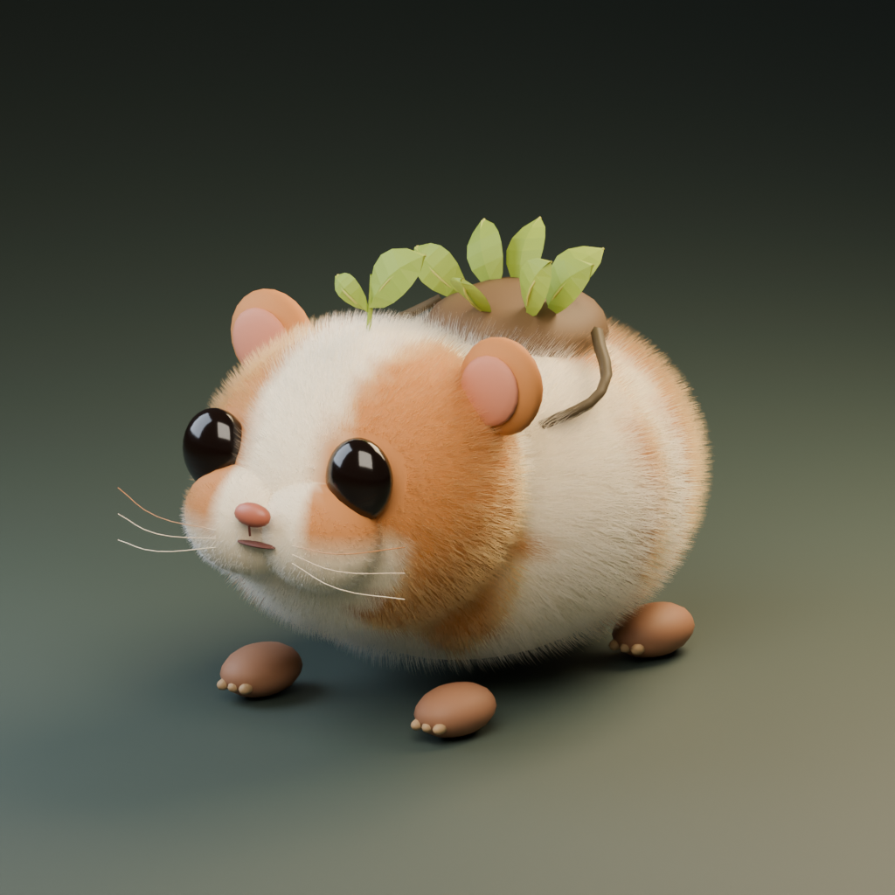
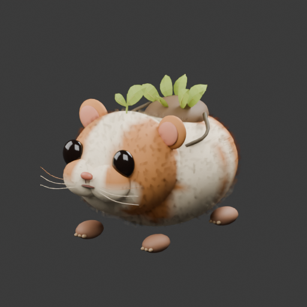
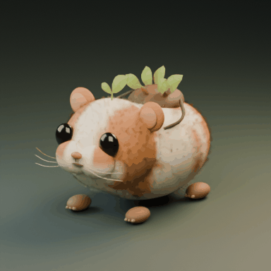

# Cuy aventurero: ejemplo, no límite del agente

Prototipo procedural estilizado creado desde primitivas, materiales y curvas locales. No usa StableGen, ComfyUI, assets de terceros o la imagen de referencia como textura. La imagen aportada por el usuario no se redistribuye.



**Esta imagen usa 70.000 hebras de presentación en Blender.** El GLB usa 2.400 tarjetas y un material base: no tiene exactamente el mismo acabado. Comparación de la versión realmente reimportada:





## Reproducir por etapas

Desde la raíz del repositorio; Python 3 externo y Blender 5.2.3 LTS. NumPy viene en el Python de Blender. No requiere Pillow ni PyYAML para modelar. Pasar ruta completa a Blender si no está en PATH.

```sh
python examples/cuy/run.py --blender blender --stage model
python examples/cuy/run.py --blender blender --stage groom
python examples/cuy/run.py --blender blender --stage rig
python examples/cuy/run.py --blender blender --stage preview
```

Cada comando realiza una sola etapa. `--output` cambia el directorio de artefactos; usar el mismo entre etapas. Los comandos posteriores requieren el anterior. El runner impone timeout y límites observados configurables; no reserva memoria ni garantiza detectar picos instantáneos. RAM se mide solo en Windows, GPU si nvidia-smi está disponible. Verificar el reporte fresco además del código de salida.

```sh
python scripts/glb_report.py artifacts/cuy/cuy-aventurero.glb
blender --background --factory-startup --disable-autoexec --python-exit-code 2 --python examples/cuy/verify.py -- --file artifacts/cuy/cuy-aventurero.glb --output artifacts/cuy/verification --render
```

El importador puede añadir una Icosphere como visualización de huesos; verify la identifica por las referencias custom_shape del rig y excluye ese auxiliar, no lo cuenta como geometría enviada al juego.

## Qué está implementado

- Cuerpo/cara redondeados, franja blanca, mochila, follaje y hoja superior.
- Dos representaciones de pelaje: curvas de presentación y tarjetas recortadas para GLB; normal map 256² y atlas 512×256.
- 23 huesos: raíz, cuerpo/cabeza, cuatro patas/pies, mochila, hoja y 10 guías de pelo.
- Shape keys Blink, OpenMouth y Smile; exportación con un clip combinado para la demostración.
- Resortes angulares amortiguados para mochila, hoja y guías, **horneados en claves**, con amplitud limitada.
- Agrupación para exportar: seis mallas, 15 primitivas/grupos de material, 13 materiales y un skin. No equivale a seis draw calls; los grupos de material también cuestan.

El GLB tiene 20.360 triángulos y unos 1,61 MiB; 21.489 vértices exportados entre primitivas. La separación de vértices por UV, color y normales explica diferencias con autoría.

## Resultados y límites

La presentación 1024²/48 muestras tardó unos 9,3 s con 761 MiB de GPU total y 1.510 MiB de RAM de Blender observados. La etapa de rig/render pequeño observó 663 MiB GPU y 709 MiB RAM. Son muestras, no máximos garantizados ni coste incremental de un personaje.

Reimportación verificada: 23 huesos, pesos normalizados, ningún vértice sin peso, valores finitos, morphs y movimiento de mochila/hoja/guía/pata en estados muestreados. Ver reportes JSON y cuatro imágenes de expresiones.

Es un prototipo con piezas superpuestas y asignaciones rígidas. Parpadeo mediante aplastamiento estilizado de ojos, boca mediante superficie exterior; no párpados/cavidad oral anatómicos. Patas con movimiento de prueba, no locomoción pulida/contacto de suelo resuelto. El clip de 72 frames a 24 fps no se ofrece como walk loop perfecto.

Las hebras Beauty quedan ocultas en el archivo rig de juego y no se exportan. Los morphs y guías animan la representación de tarjetas. No hay solver general de colisiones, física interactiva de motor, IK, LOD implementado, Animator Unity o benchmark móvil validado. La lógica de juego y física interactiva requieren la integración correspondiente.

Blender emitió avisos de controlador antiguo y fallos auxiliares del entorno al registrar extensiones/cache; no impidieron guardar, renderizar o exportar. Un fallo Python anterior con salida 0 motivó el runner con --python-exit-code y reporte fresco. No se cambiaron controladores o preferencias globales.
